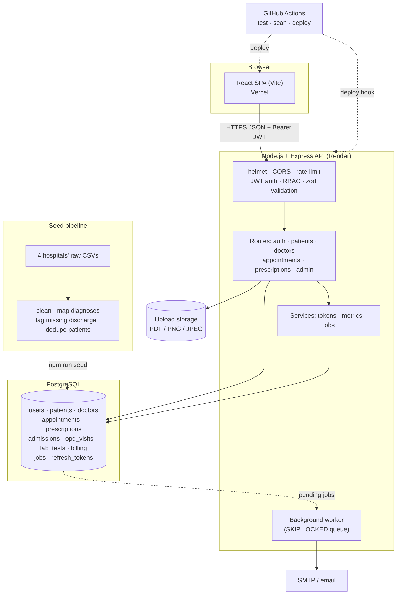
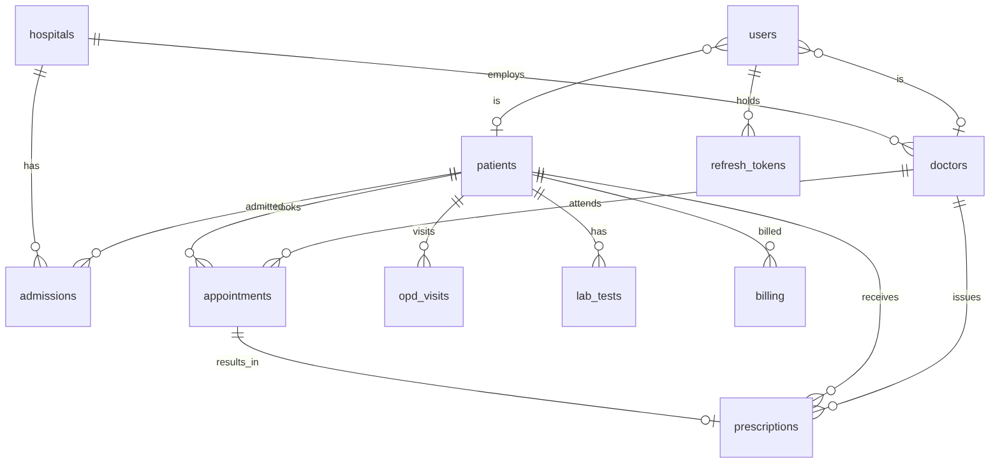

# Architecture

## Decisions
- **Modular monolith** (one API, one DB). A TPA clinic system does not need microservices; module boundaries (routes → services → db) allow splitting later.
- **PostgreSQL** — relational data with integrity rules (unique doctor slot via partial unique index, FK cascades) and analytics (admissions) in one engine.
- **Auth** — 15-min stateless JWT for speed; opaque rotating refresh token stored hashed so sessions can be revoked. Access token lives in memory in the SPA, refresh token in localStorage (trade-off: XSS exposure vs. surviving reloads; mitigated by helmet, no HTML injection, short access TTL. For stricter setups use an httpOnly cookie).
- **Validation twice** — UX on the client, authority on the server (zod). Unknown fields are stripped (so `role` cannot be injected at sign-up).
- **Data pipeline as pure functions** — parsing, diagnosis mapping, de-duplication and metrics are dependency-free modules covered by unit tests, independent of Express/DB.
- **Queue in Postgres** — `jobs` table + `FOR UPDATE SKIP LOCKED`; transactional enqueue (a job exists iff the appointment commit succeeded); no extra infrastructure. Retries with exponential back-off, 5 attempts.
- **Observability** — JSON logs (request, auth, job events); secrets redacted; `/health` for the platform.

## Request flow (book appointment)
1. SPA validates → `POST /api/appointments` with Bearer token (auto-refresh on 401).
2. Middleware: helmet → CORS → body limit → `authenticate` → zod `validate`.
3. Transaction: insert appointment (unique slot index guards double-booking) + enqueue email job.
4. Worker claims the job, sends mail via SMTP (or logs when SMTP is unset).
